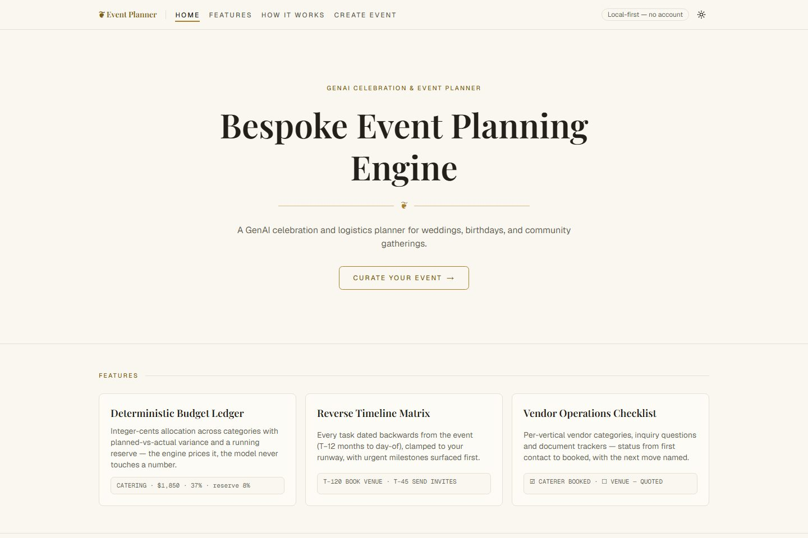
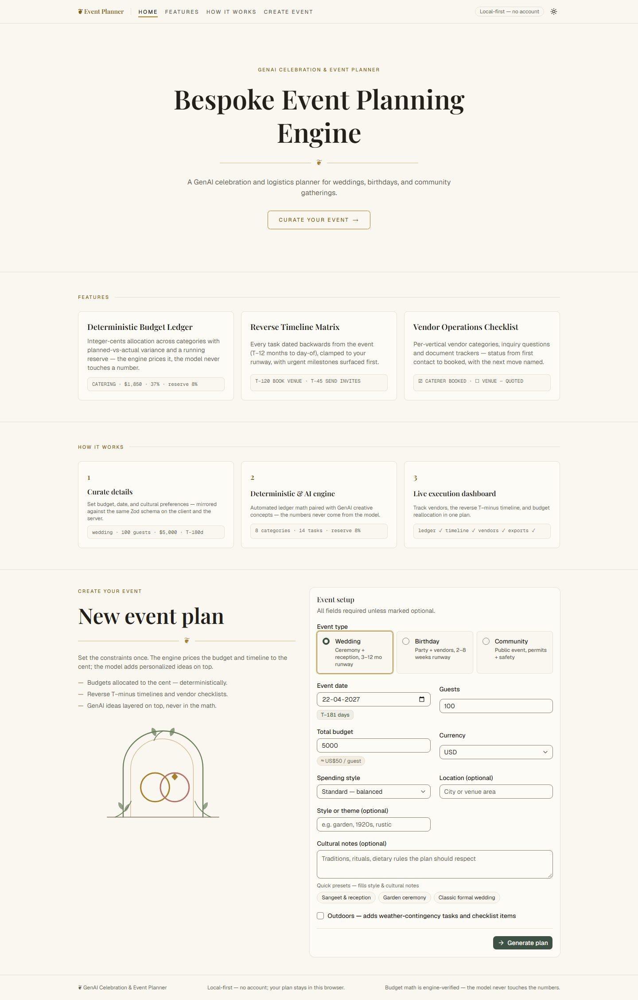
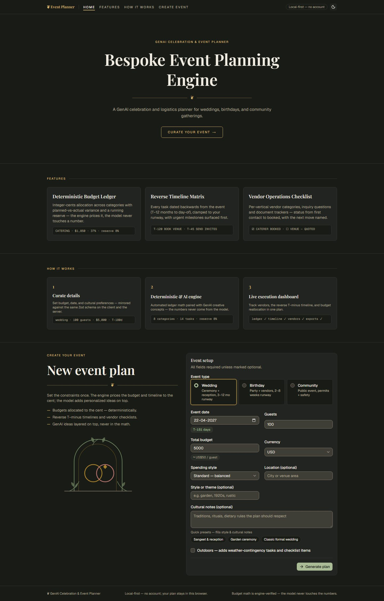
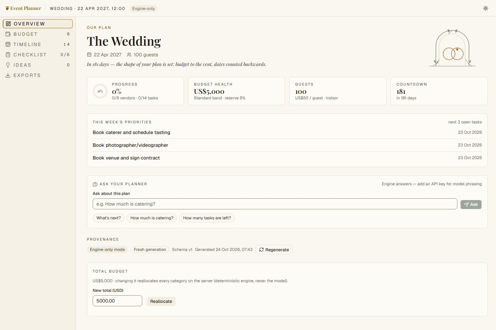
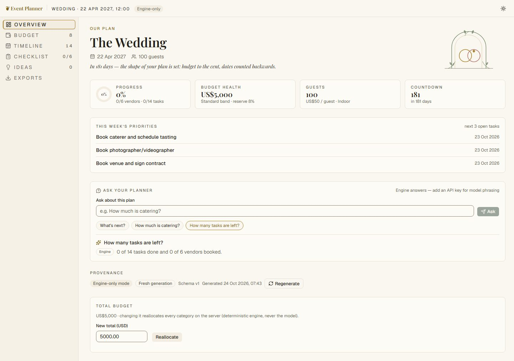
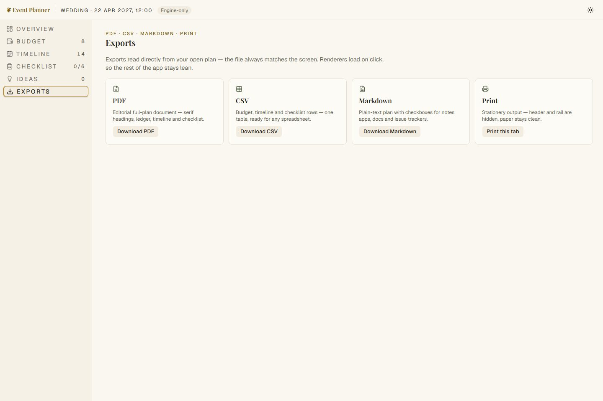
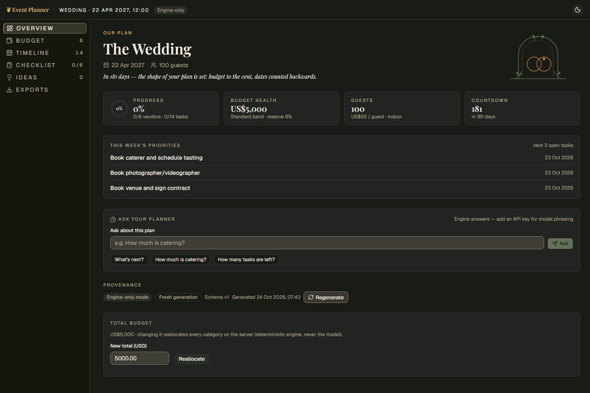

# ❦ GenAI Celebration & Event Planner

[](https://github.com/Sharon-Sam14/Prompt-War/actions/workflows/quality.yml)

An editorial-grade planning assistant for **celebrations and events** — budgets priced to
the cent, reverse T−minus timelines, vendor checklists with inquiry questions, and
personalized GenAI ideas on top. Built as premium event stationery: Playfair Display +
Geist, cream-paper light theme, ink-paper dark theme, WCAG AA proven by test in both.



---

## 1. Chosen vertical

**Celebration & event planning** with all three required event types as first-class
verticals — never wedding-centric:

| Vertical      | Distinct engine templates                                                                  | Accent identity |
| ------------- | ------------------------------------------------------------------------------------------ | --------------- |
| **Wedding**   | ceremony/reception weightings, sangeet-scale runway tasks, attire + photography checklists | sage + rose     |
| **Birthday**  | party/catering weightings, 2–8 week runway, entertainer + cake checklist                   | rose + gold     |
| **Community** | permits/safety weightings, public-event tasks, steward + first-aid checklist               | blue + sage     |

Each vertical drives its own budget weightings, timeline defaults, checklist categories,
idea prompts, and a per-vertical accent remap (`data-vertical` in `app/globals.css`,
Design.md §2).

## 2. Approach and logic

**Hybrid architecture: a deterministic rules engine owns all math; a real LLM adds
qualitative enrichment on top.** Chatbots hallucinate costs and deadlines — so the model
is never allowed to produce a cent or a date. It returns _percentages_ and _day-offsets_
only; the engine converts those to absolute values, and every boundary is Zod-validated
(up to two retries with bounded backoff and jitter, then a deterministic fallback).

### Required features → where they live

| Required feature                                         | Implementation                                                                                                                                                                                                                                                                                                                                                            |
| -------------------------------------------------------- | ------------------------------------------------------------------------------------------------------------------------------------------------------------------------------------------------------------------------------------------------------------------------------------------------------------------------------------------------------------------------- |
| **GenAI-powered** (real LLM)                             | `lib/genai/client.ts` — `generateObject()` + Zod schema `LlmEnrichmentSchema`, prompt-guarded (`lib/security/prompt-guard.ts`), LRU-cached, up to 2 retries with bounded backoff → fallback; routed by `app/api/plan/route.ts`                                                                                                                                            |
| **Assistant behavior** (conversational, follows context) | `POST /api/ask` (`app/api/ask/route.ts`) + `components/planner/assistant-panel.tsx`: each request ships a **plan-context snapshot** plus at most the last 3 messages; keyless → deterministic responder `lib/rules-engine/ask.ts`; keyed → LLM phrasing with bounded retries; source is labeled in the UI                                                                 |
| **Budgets**                                              | `lib/rules-engine/budget.ts` reading weight tables from `lib/config/budget.ts` (per-vertical × per-band weightings, contingency reserve), server action `recalculateBudget` (`app/actions.ts`), ledger UI `components/planner/budget-table.tsx` — editable planned/actual cells (Enter commits, Escape reverts), share bars, `aria-live` totals, server-verified variance |
| **Timelines**                                            | `lib/rules-engine/timeline.ts` reading offsets from `lib/config/timeline.ts` — tasks generated **backwards** from the event date (T−12 months → day-of), engine clamps any model offset to the runway; `components/planner/timeline-view.tsx` groups tasks under phase headings, pages lists over 30 items, urgent T−N chips, roving-tabindex keyboard control            |
| **Vendor checklists**                                    | `lib/rules-engine/checklist.ts` instantiating per-vertical templates from `lib/config/checklist.ts` — categories, generated inquiry questions and document trackers; `components/planner/vendor-checklist.tsx` accordion with status select (`To contact → Contacted → Quoted → Booked`)                                                                                  |
| **Personalized ideas**                                   | `lib/rules-engine/ideas.ts` guarantees contextual ideas for vertical/band/per-guest/guest count/outdoor/theme/cultural notes; model ideas append through `lib/genai/prompts.ts`; `components/planner/ideas-view.tsx` labels each source                                                                                                                                   |
| **All three verticals**                                  | templates in `lib/config/*` (weights, timeline offsets, checklists, idea rules) + engine logic in `lib/rules-engine/*` + accent remaps in `app/globals.css` + vignette art in `public/images/vignettes/`                                                                                                                                                                  |
| **Logical decision making**                              | budget band → category weights; `isOutdoor: true` → weather-contingency tasks (verified: outdoor community plan carries 2); runway → task filtering; prompt-guard delimits all user content against injection                                                                                                                                                             |
| **Real-world usability**                                 | end-to-end flow below + exports: PDF (jsPDF), CSV (`@json2csv/plainjs`), Markdown, Print — all lazy-loaded on click (`components/planner/exports-panel.tsx`), all read from the store so screen ≡ export                                                                                                                                                                  |

### Decision rules (sample)

- `budgetBand: micro | standard | premium` → baseline category weight table → integer-cents
  allocation that **sums exactly to the total** (asserted in tests).
- `isOutdoor` → tent/weather tasks and checklist items; indoor → venue-focus tasks.
- Model-proposed `offsetDays` are clamped to `[0, runway]`; dates are always engine-computed.
- Past event dates, zero guests, oversized budgets → field-level 400s, never 500s.

## 3. How it works

```
Setup (/)                     Engine + Model                    Dashboard (/plan/[id])
┌──────────────────┐   POST   ┌─────────────────────┐   hydrate  ┌─────────────────────┐
│ vertical · date  │ ───────► │ rules engine:       │ ─────────► │ Overview · Budget   │
│ guests · budget  │ /api/plan│  allocation         │  Zod ✓     │ Timeline · Checklist│
│ presets · notes  │          │  reverse timeline   │            │ Ideas · Exports     │
│ live T− / ≈guest │          │ LLM: pct/offsets    │            │ Ask-your-planner    │
└──────────────────┘          │  (keyless → skip)   │            └─────────────────────┘
                              └─────────────────────┘                    │
                                                                         ▼
                                        localStorage `promptwar-planner` · /plan/<uuid>
```

1. **Curate details** — the setup form mirrors `PlanInputSchema` client-side; live
   previews (T− chip, ≈ per-guest badge) are display-only, the server owns the math.
2. **Generate** — `POST /api/plan`: rate limit (10/min/IP) → Zod → engine baseline →
   prompt-guarded LLM enrichment (cached) → hydration merge (engine math wins) →
   Zod re-validation → plan stored **locally**, URL `/plan/<uuid>` is bookmarkable on this device; use JSON export/import to move a plan between devices.
3. **Work the plan** — six tabs: command-center overview (progress ring, budget health,
   per-head, countdown, priorities, server-side budget reallocation, conversational
   assistant), editable ledger, reverse timeline, vendor accordion, filtered ideas, exports.
4. **Export** — PDF/CSV/Markdown render from the same store; `@media print` CSS hides
   app chrome and re-keys dark mode for paper.

**Session model:** guest/local-first by deliberate choice — no login, no server-side
plan storage, no PII beyond the plan itself (Design.md §3).

## 4. The six evaluation parameters → artifacts

| Parameter                       | Artifacts                                                                                                                                                                                                                                                                                                                                                                                 |
| ------------------------------- | ----------------------------------------------------------------------------------------------------------------------------------------------------------------------------------------------------------------------------------------------------------------------------------------------------------------------------------------------------------------------------------------- |
| **Code Quality**                | docs-first protocol (`docs/Design.md` spec, `docs/Memory.md` decision log D1–D42), typed contracts in `lib/genai/schemas.ts` (Zod boundaries), pure testable engine modules reading config from `lib/config/*`, no `any`, zero lint errors, Prettier-clean                                                                                                                                |
| **Security**                    | server-only GenAI layer (key never reaches the client), prompt-guard (sanitize + delimit + injection heuristic), per-IP route and Server Action limits (`lib/security/rate-limit.ts`), Zod validation on untrusted bodies and persisted plans, CSP and browser security headers, no secrets in repo, audit + secret-scan records in §8                                                    |
| **Efficiency**                  | LRU-cached LLM calls (identical context = 0 tokens), `maxOutputTokens` caps, export libraries **lazy-imported on click** (verified: jsPDF/json2csv absent from both routes' initial JS graphs), no per-keystroke calls, PPR/static where possible                                                                                                                                         |
| **Testing**                     | 368 tests: engine math and contextual ideas, prompt-guard, raw-HTML security boundary, contrast proof (281 assertions × 8 scenarios), motion contract (`planReveal`, reduced-motion), API routes with **mocked** AI SDK (no token spend), assistant responder + limiter, Playwright E2E (happy path with axe and JSON round-trip, motion-settled assertions, keyboard-only critical flow) |
| **Accessibility**               | semantic landmarks + heading order, real buttons/labels, visible focus, roving tabindex, matching `aria-orientation` on the vertical plan tablist, `aria-live` for totals/answers/status, `aria-expanded` accordion, non-color-only states, `prefers-reduced-motion` honoured in CSS **and** JS, WCAG AA contrast in **both themes** (test-enforced), Lighthouse a11y 100                 |
| **Problem Statement Alignment** | all six required features mapped above; all three verticals; conversational assistant + structured generation; deterministic decision rules; usable end-to-end flow with exports                                                                                                                                                                                                          |

## 5. Testing

### Commands

```bash
npm test           # vitest — unit + integration (mocked LLM, no tokens)
npm run test:e2e   # Playwright — full browser flow against the production build
```

### Test inventory

| File                                     | Covers                                                                                                                                                                                                                                                                                          |
| ---------------------------------------- | ----------------------------------------------------------------------------------------------------------------------------------------------------------------------------------------------------------------------------------------------------------------------------------------------- |
| `tests/unit/rules-engine.test.ts`        | allocation sums to the cent, band × vertical weights, reverse dates, runway clamping                                                                                                                                                                                                            |
| `tests/unit/prompt-guard.test.ts`        | sanitization, delimiting, injection heuristics                                                                                                                                                                                                                                                  |
| `tests/unit/theme-contrast.test.ts`      | **281 assertions × 8 scenarios** — parses `app/globals.css` and proves WCAG AA for every token pair in light/dark × all verticals                                                                                                                                                               |
| `tests/unit/motion.test.ts`              | motion contract: `planReveal` stagger caps, reduced-motion → zero duration, final value in the DOM for AT, no arming class left behind                                                                                                                                                          |
| `tests/unit/ask.test.ts`                 | deterministic assistant answers, "never quotes a number not in the snapshot", derived facts, rate-limiter factory                                                                                                                                                                               |
| `tests/integration/api-plan.test.ts`     | mocked LLM happy path, cache hit, retry → fallback, keyless Gate 1, 400s including the guest-count boundary (10,000 accepted, 10,001 rejected), 10/min rate limit                                                                                                                               |
| `tests/integration/api-ask.test.ts`      | engine mode, LLM mode (mocked), cache, validation, 30/min rate limit                                                                                                                                                                                                                            |
| `tests/unit/security-boundaries.test.ts` | rejects `innerHTML` and `dangerouslySetInnerHTML` in shipped UI code                                                                                                                                                                                                                            |
| `tests/e2e/planner.spec.ts`              | 3 tests: (1) skip link, axe in both themes, 320 px/200% zoom, setup → generate → edit → assistant → PDF/CSV/MD/JSON export/import, reload persistence; (2) motion enabled — reveals and count-ups settle on the engine's value; (3) **keyboard only** — the whole critical flow with no pointer |

Run the API checks yourself (server up):

```bash
npm run build && npm run start
# in another shell
curl -X POST http://localhost:3000/api/plan -H "content-type: application/json" \
  -d '{"vertical":"birthday","eventDate":"2027-06-01T12:00:00.000Z","guestCount":25,"budgetTotalCents":350000,"currency":"USD","budgetBand":"micro","isOutdoor":false}'
```

## 6. Assumptions & known limitations

- **Keyless by design.** No `OPENAI_API_KEY` → engine-only mode: deterministic contextual
  ideas, budgets, timelines and checklists remain available; the assistant answers from plan
  data. A key adds model-enriched ideas and phrasing.
- **Guest/local-first (no auth).** Plans live in `localStorage` under `promptwar-planner`;
  opening `/plan/<uuid>` on a different device shows "No saved plan here". Transfer the
  complete plan with JSON export/import. There is no cloud sync or server-side plan storage.
- **Single-process rate limiting & LRU cache.** In-memory by design (no Redis): limits are
  per-instance in a multi-instance deploy — acceptable for a single-container deployment.
- **Assistant scope.** The conversational layer answers _from the plan snapshot_ (budget,
  timeline, vendors, per-guest, weather, ideas status). Open-ended chit-chat falls back to
  a capability statement rather than inventing content.
- **Print output** assumes standard browser printing (backgrounds stripped by default);
  dark-mode users get the light paper palette re-keyed via `@media print`.
- **Model enrichment is qualitative only** — percentages and offsets, clamped by the
  engine; malformed model output gets at most two retries with backoff and jitter under the
  20-second request timeout, then the deterministic fallback.
- **Motion is a filtered subset, not a library drop.** `components/motion/` owns two
  primitives (`CountUp`, `Reveal`) with `motion` as the only added dependency; the heavier
  React Bits variants were rejected (§9). Everything degrades to a static, fully visible
  result under `prefers-reduced-motion: reduce`.
- **Keyboard-only QA is automated, not a claim.** Step 3 of the Playwright suite drives the
  entire critical flow with no pointer and fails if any control becomes unreachable or focus
  escapes to `<body>`; Playwright also runs axe against landing and dashboard in both themes
  and checks horizontal overflow at 320 px and 200% zoom. Contrast remains independently
  test-enforced.
- **Submission shape.** Public repo `Sharon-Sam14/Prompt-War`, single branch `main`, no
  tags; **attempts used: 0 of 3** (logged in `docs/Memory.md` §6).

## 7. Quick start

```bash
npm install
npm run dev          # → http://localhost:3000
```

**No API key required.** Without `OPENAI_API_KEY` the app runs in honest _engine-only
mode_: every number, date and checklist is generated by the deterministic rules engine,
and the UI says `Engine-only` instead of pretending a model answered. With a key, the
LLM layer adds personalized ideas and model phrasing — it **never** does arithmetic.

```powershell
# optional, PowerShell
$env:OPENAI_API_KEY = "sk-..."
npm run dev
```

### Quality gates (run in this order)

```bash
npx eslint .            # lint: 0 errors
npx prettier --check .  # formatting: 0 issues
npx tsc --noEmit        # types: clean
npm test                # 8 files, 368 tests
npm run build           # production build (PPR, Turbopack)
npm run test:e2e        # Playwright E2E — starts its own server, 3 tests
npx lhci autorun        # Lighthouse CI — a11y ≥ 95, best-practices ≥ 90
```

GitHub Actions runs all seven gates on every push and pull request
(`.github/workflows/quality.yml`); the badge at the top of this README reports the latest
run.

Expected tail of `npm test`:

```
 Test Files  8 passed (8)
      Tests  368 passed (368)
```

Expected tail of `npm run test:e2e`:

```
  3 passed (…s)
```

Expected tail of `npx lhci autorun`:

```
Healthcheck passed!
Checking assertions against 1 URL(s), 1 total run(s)
```

…with the scores in §9 below (performance 100, accessibility 100, best-practices 96, SEO 100).

## 8. Responsible AI and data handling

The optional model receives event type, date, guest count, integer-cent budget, currency,
budget band, outdoor status, and the optional location/theme/cultural notes. Assistant
requests also include a compact plan snapshot and at most the last three chat messages.
Free text is sanitized and delimited before prompt use. No name, email, or account profile
is collected. `OPENAI_API_KEY` is read on the server only.

Plans are stored in this browser's localStorage. The server does not store plans; JSON
exports are files controlled by the user. Requests use an in-memory per-IP rate limiter.
Generated budgets and vendor suggestions are planning guidance, not quotes. Confirm prices
and availability with vendors.

**Model choice.** One small, fast model — `gpt-4o-mini` (override with `OPENAI_MODEL`) —
serves both the assistant and plan enrichment. Rationale: the model never computes
anything (it only phrases engine-computed facts and returns qualitative percentages and
day-offsets), so a larger model would add latency and cost without improving correctness;
the engine and the Zod schemas own quality. Swapping `OPENAI_MODEL` needs no code change.

**Verification record.** `npm audit --omit=dev` → **0 vulnerabilities** in the shipped
dependency tree. The 16 remaining advisories all sit in dev-only tooling
(Lighthouse/Puppeteer/Playwright transitive chains) whose fixes require breaking major
bumps — they never reach users, so they are recorded here rather than papered over with
`audit fix --force`. A `git log -p` secret scan (`sk-…`, `ghp_…`, `OPENAI_API_KEY=<value>`)
is **clean**: only `.env.example` (placeholder, no key) is committed, `.env*` is gitignored,
and the lockfile is committed.

> Estimates and vendor suggestions are planning guidance, not quotes. Confirm prices and
> availability with vendors.

## 9. Efficiency

| Area            | Behavior                                                                                                         |
| --------------- | ---------------------------------------------------------------------------------------------------------------- |
| Plan generation | One LLM call when configured; zero in keyless mode or on an identical cache hit                                  |
| Assistant       | One call per question when configured; only the latest three messages are sent                                   |
| Output caps     | 4,000 tokens for plan enrichment; 300 for assistant answers                                                      |
| LLM bound       | 20 second overall timeout; at most 2 retries with exponential backoff/jitter, then deterministic engine fallback |
| Cache           | 200-entry in-memory LRU, 15 minute TTL, SHA-256 request key with prompt version                                  |
| Exports         | PDF/CSV libraries are dynamically imported on click; JSON and Markdown use browser APIs                          |

### Motion layer (§1.7 contract)

| Artifact                         | Origin                                     | Decision              | Rationale                                                                                                     |
| -------------------------------- | ------------------------------------------ | --------------------- | ------------------------------------------------------------------------------------------------------------- |
| `components/motion/count-up.tsx` | React Bits `CountUp-TS-TW` (TS + Tailwind) | **Adopted**, stripped | its only dependency is `motion` (already present); unused props and hardcoded hex/gradient/glow/blur removed  |
| `components/motion/reveal.tsx`   | written in-repo                            | **Owned code**        | a stagger/rise reveal needs no dependency at all — this replaced the gsap candidates                          |
| React Bits `FadeContent`         | gsap                                       | **Rejected**          | pulls `gsap` (27.8 KB gzip) + ScrollTrigger (17.6 KB gzip) = **45.4 KB gzip**, past the 30 KB cap on its own  |
| React Bits `SplitText`           | gsap                                       | **Rejected**          | same gsap cost; also splits text into per-character nodes, which degrades screen-reader output                |
| React Bits `AnimatedContent`     | gsap                                       | **Rejected**          | same gsap cost                                                                                                |
| React Bits `AnimatedList`        | own CSS                                    | **Rejected**          | hardcoded hex + `linear-gradient` + `backdrop-blur` + icon deps — violates the design contract (Design.md §2) |

Contract honoured: motion only in `"use client"` leaf files; no three.js/ogl/WebGL; no
layout shift; only the **first** mount animates; reveals arm through an
`IntersectionObserver({ threshold: 0.4 })` with a 1200 ms safety fallback so nothing can
stay invisible; `prefers-reduced-motion: reduce` disables motion in CSS **and** JS (the
arming class is never applied); the `CountUp` final value is in the DOM twice — an
`aria-hidden` animated span plus an `sr-only` twin carrying the engine's exact value.

### Bundle budget (measured, gzipped)

Every `<script src>` in the production HTML for each route, gzipped and summed:

| Route        | Without motion layer      | With motion layer (shipped) | Δ             |
| ------------ | ------------------------- | --------------------------- | ------------- |
| `/`          | 272,337 B (266.0 KB) gzip | 272,875 B (266.5 KB) gzip   | **+538 B**    |
| `/plan/[id]` | 285,473 B (278.8 KB) gzip | 308,420 B (301.2 KB) gzip   | **+22,947 B** |

Total added JS ≈ **23.0 KB gzip** — inside the **< 30 KB gzip** §1.7 cap. CSS bundle:
70,239 B uncompressed. (Figures are whole-route totals including the React/Next runtime; the
motion cost is the Δ column.)

> `next build` must run on Turbopack (the Next 16 default). `next build --webpack` bypasses
> the `turbopack.rules` Tailwind loader in `next.config.ts` and ships **uncompiled** CSS
> (raw `@theme` at-rules, zero utilities) to production.

### Lighthouse CI

`npx lhci autorun` against the production build — desktop preset, thresholds in
`.lighthouserc.json` (accessibility ≥ 0.95 and best-practices ≥ 0.90 hard errors,
performance ≥ 0.90 a warning):

| Category       | Score   |
| -------------- | ------- |
| Performance    | **100** |
| Accessibility  | **100** |
| Best practices | **96**  |
| SEO            | **100** |

Metrics: FCP 0.3 s · LCP 0.7 s · **CLS 0** · TBT 0 ms · Speed Index 0.5 s · TTI 0.7 s.

## 10. Manual QA matrix

### Tested scenarios (three verticals × budget tiers)

| Vertical  | Tier              | Scenario                                                                          | Result                                |
| --------- | ----------------- | --------------------------------------------------------------------------------- | ------------------------------------- |
| Wedding   | micro             | Engine allocation coverage                                                        | Automated                             |
| Wedding   | standard          | Full Playwright flow, both themes, preset, live previews, exports and JSON import | ✅ Passed                             |
| Wedding   | premium           | Engine allocation coverage                                                        | Automated                             |
| Birthday  | micro             | `POST /api/plan` ($3,500 / 25 guests)                                             | ✅ 200, totals exact                  |
| Birthday  | standard          | Engine allocation coverage                                                        | Automated                             |
| Birthday  | premium           | Engine allocation coverage                                                        | Automated                             |
| Community | micro             | Engine allocation coverage                                                        | Automated                             |
| Community | standard          | Engine allocation coverage                                                        | Automated                             |
| Community | premium           | `POST /api/plan` ($120,000 / 500 guests, outdoor)                                 | ✅ exact totals, 2 weather tasks      |
| —         | keyboard-only     | Manual critical-flow run                                                          | ✅ Passed (now automated — see below) |
| —         | reduced motion    | Full flow under `prefers-reduced-motion: reduce`                                  | ✅ Passed (Playwright default)        |
| —         | keyless assistant | `POST /api/ask`                                                                   | ✅ engine answer based on snapshot    |

### Keyboard-only end-to-end run (recorded)

Performed **2026-10-24** · production build (`npm run build && npm run start`) · Chromium,
1280 × 900 · no pointer input at any point. Step 3 of `tests/e2e/planner.spec.ts`
(`keyboard only › critical flow is operable without a mouse`) reproduces exactly this run,
so the result is re-verified on every CI push rather than being a one-off manual note.

| #   | Step             | Keys used                       | Result                                                                                                                               |
| --- | ---------------- | ------------------------------- | ------------------------------------------------------------------------------------------------------------------------------------ |
| 1   | Skip to content  | `Tab`, `Enter`                  | ✅ focus lands on the skip link, `#main-content` reached                                                                             |
| 2   | Theme toggle     | `Tab`…, `Enter` ×2              | ✅ toggles to dark and back, focus returns to the toggle                                                                             |
| 3   | Event type       | `Tab`…, `→` / `←`               | ✅ radio selection follows arrow keys                                                                                                |
| 4   | Setup form walk  | `Tab` ×11 stops                 | ✅ date → guests → budget → currency → style → location → theme → notes → preset → outdoor → submit; focus never escapes to `<body>` |
| 5   | Preset fill      | `Enter` on preset               | ✅ cultural notes become "Sangeet …"                                                                                                 |
| 6   | Outdoor checkbox | `Space`                         | ✅ checked                                                                                                                           |
| 7   | Generate         | `Enter`                         | ✅ `/plan/<uuid>` loads with the expected heading                                                                                    |
| 8   | Dashboard tabs   | `Tab`…, `↓` / `↑`               | ✅ vertical tablist: Overview → Budget → … → Exports, `aria-selected` follows                                                        |
| 9   | Assistant        | `Tab`…, `Enter`                 | ✅ answer text appears in the live region                                                                                            |
| 10  | Budget ledger    | `Tab`…, `Ctrl+A`, type, `Enter` | ✅ cell commits `777.00`                                                                                                             |
| 11  | Timeline task    | `Tab`…, `Space`                 | ✅ task toggles to `aria-checked="true"`                                                                                             |
| 12  | Checklist status | `Enter`, `↓`, `Enter`           | ✅ `To contact` → `Contacted` committed                                                                                              |
| 13  | Exports          | `Tab`…, `Enter`                 | ✅ CSV download fires with a `.csv` filename                                                                                         |

No step required a pointer, and the run finishes with `pageErrors === []`.

## 11. Documentation map

| Doc                       | Contents                                                                 |
| ------------------------- | ------------------------------------------------------------------------ |
| `docs/PRD.md`             | requirements & acceptance criteria                                       |
| `docs/Design.md`          | normative UI spec: anti-slop rules, tokens, layout, components §4.1–4.13 |
| `docs/Architecture.md`    | system design, data flow, prompt/LLM boundaries                          |
| `docs/Phases.md`          | phase plan with acceptance criteria (1.0 – 4.18)                         |
| `docs/Memory.md`          | decision log, execution log, gate results                                |
| `docs/Rules.md`           | repo conventions (docs-first, gates order, color contract)               |
| `docs/Frontend-Prompt.md` | consolidated frontend mandate                                            |

## 12. Screenshots

|                                                             |                                                           |
| ----------------------------------------------------------- | --------------------------------------------------------- |
|  |          |
|    |  |
|              |    |

Refresh them with `node scripts/screenshots.mjs` (server running, production build).
